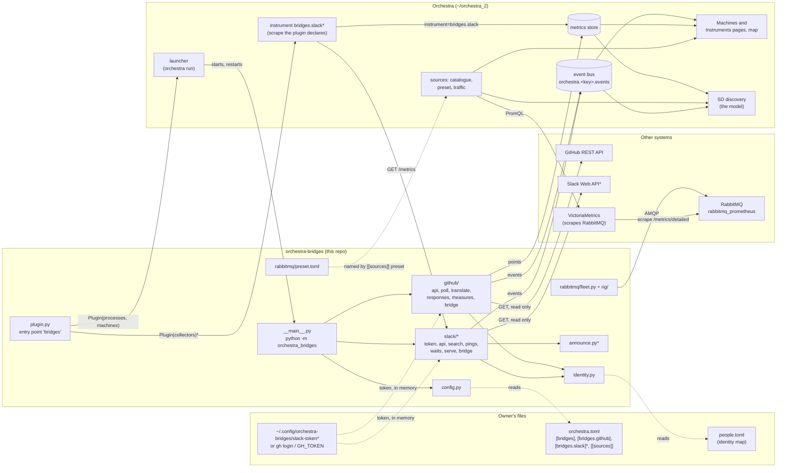
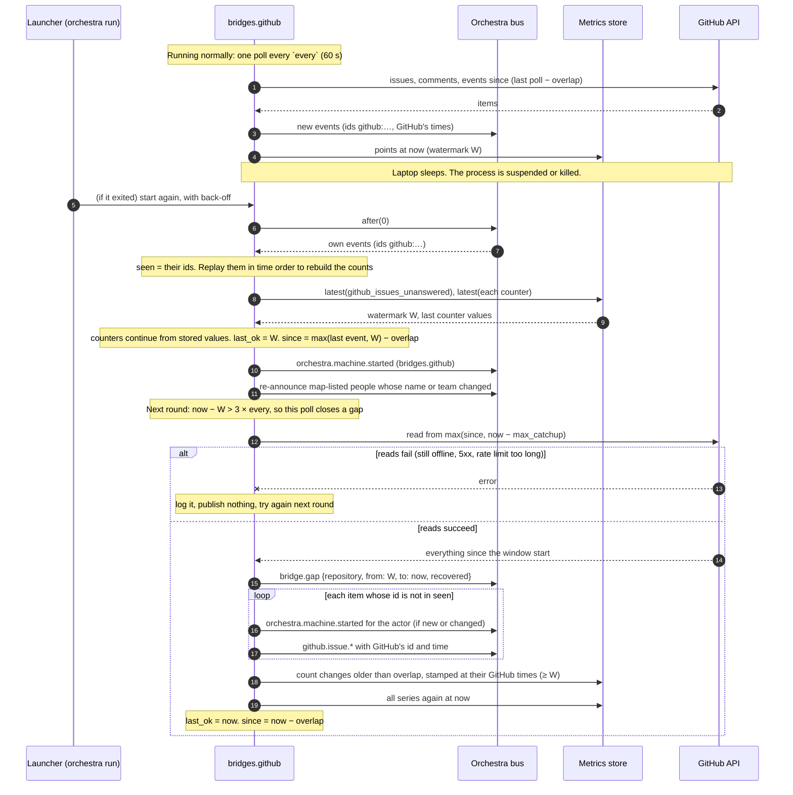
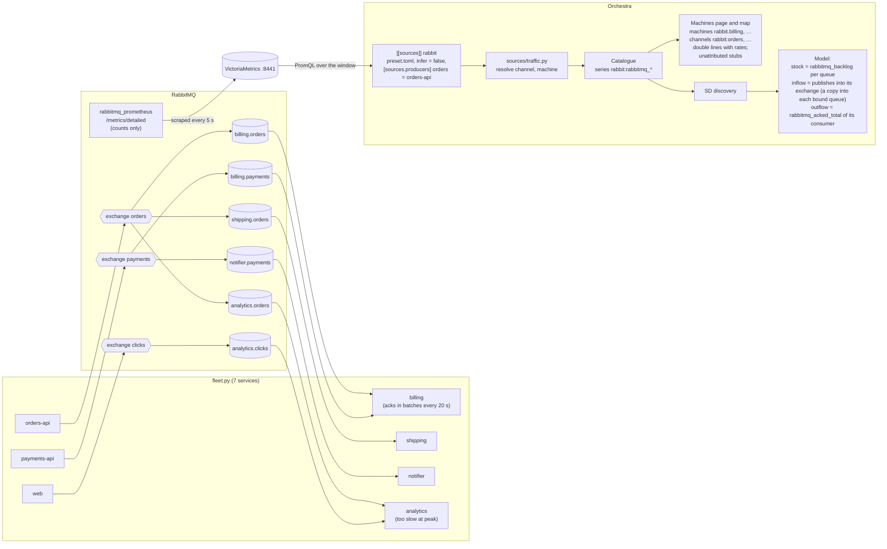
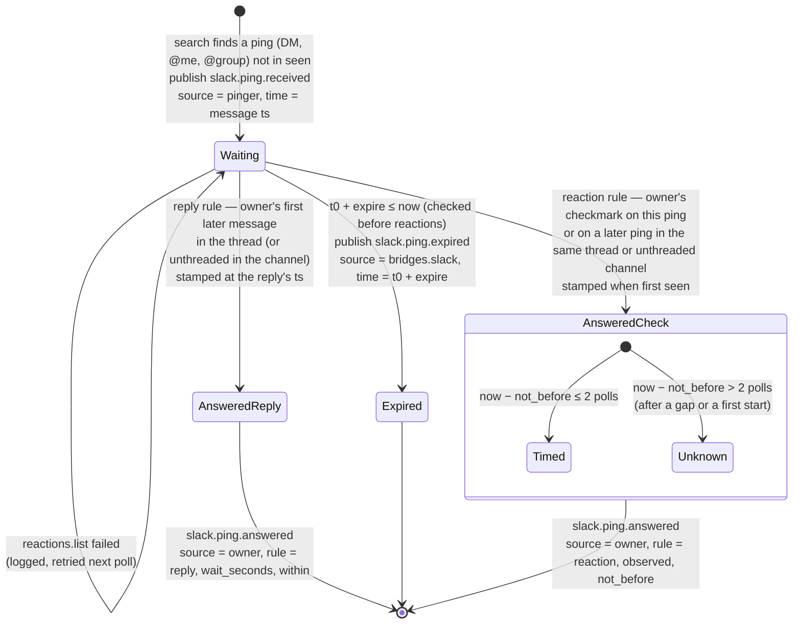
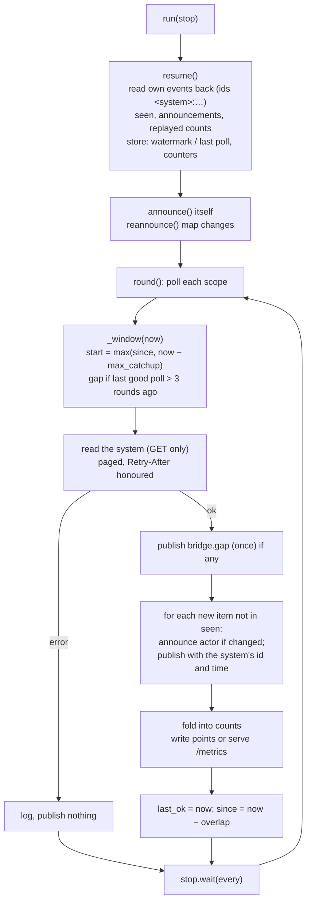

# orchestra-bridges: architecture

This document explains how orchestra-bridges works and why it is built this way. It is written
for two readers: the owner, who runs it on a laptop that sleeps, and engineers new to the code.
`SPEC.md` is the design and `AGENTS.md` lists the rules. This document links them to the code,
which was checked statement by statement on 2026-10-27, and draws the moving parts. It was
brought up to date the same day with Orchestra's instruments (Orchestra `8344264c`: collectors and
scrapes are instruments, not machines) and the branch commit that follows them.

Throughout, every part is marked by status:

- **Built (main)**: on `main`, tested.
- **Branch (`slack-bridge`)**: built and tested on the branch `slack-bridge` (commit `aae18aa`,
  not merged; `45fb844` is the last one pushed). It is not on `main` yet.
- **Proposed**: designed in Orchestra's `docs/proposals/event-sources.md`, not built.

## Contents

1. [What it is for](#1-what-it-is-for)
2. [Status at a glance](#2-status-at-a-glance)
3. [The parts](#3-the-parts)
4. [How it plugs into Orchestra](#4-how-it-plugs-into-orchestra)
5. [The GitHub issues bridge (main)](#5-the-github-issues-bridge-main)
6. [Counted traffic: the RabbitMQ preset and rig (main)](#6-counted-traffic-the-rabbitmq-preset-and-rig-main)
7. [The Slack pings bridge (branch `slack-bridge`)](#7-the-slack-pings-bridge-branch-slack-bridge)
8. [Contracts](#8-contracts)
9. [Add a new bridge](#9-add-a-new-bridge)
10. [Proposed, not built](#10-proposed-not-built)
11. [Where the docs and the code disagree](#11-where-the-docs-and-the-code-disagree)

---

## 1. What it is for

Orchestra is an event bus, a metrics store and a system dynamics model of the system that uses
them. It knows a machine only by its events on the bus, or by counted traffic on another system's
bus (Orchestra's rules 1 and 2). Metrics are measurements of the system, taken by instruments; a
series never makes a machine, and a machine is associated with a flow only as a hypothesis
Orchestra infers from its events (rules 6 and 7). Much of the work that matters happens elsewhere: in issue trackers, in chat, and on other
companies' message brokers. This package brings that work in, in three ways:

| What we care about | How it arrives | Where |
|---|---|---|
| **Other systems' activity as machines and events.** An issue opened, a comment, a Slack ping and its answer | A **bridge** polls the system and publishes real CloudEvents on Orchestra's bus. The source is the actor and the subject is the item | `orchestra_bridges/github/` (main), `orchestra_bridges/slack/` (branch) |
| **People as machines, with names and teams** | Each actor becomes an event `source` (`person.<key>`, `bot.<key>`). The bridge announces each one with `orchestra.machine.started`, giving the name and team from the owner's identity map | `identity.py` (main), `announce.py` (branch) |
| **Counted traffic.** What producers put into a broker and consumers took out, without reading a message | A **preset** of series definitions that Orchestra's `[[sources]]` reads from a Prometheus-compatible store. Nothing is published on the bus | `orchestra_bridges/rabbitmq/` (main) |

A bridge is a **machine outside Orchestra** (Orchestra's rule 1: the core knows no tickets or
pings). Orchestra counts bridged events by type and source like any others, so flows, the Machines
page, and hand-offs (one machine acting on a subject after another) come with no extra work.

Every bridge holds to the rules in `AGENTS.md`:

1. **Never text.** It publishes metadata only. Titles, bodies and messages pass through memory and
   are never published, written or logged.
2. **Read only.** It never writes to the system it reads: no comments, labels or reactions.
3. **The token stays in memory.** It is never written, logged or published, and it is sent only
   to the configured API host.
4. **No state of its own.** What it knows comes from its own events on the bus and its own series
   in the store, rebuilt at start.
5. **Through Orchestra's library only.** It uses `orchestra.events`, `orchestra.metrics`,
   `orchestra.plugins`, `orchestra.launcher.Process` and, on the branch,
   `orchestra.collect.spec.Collector`.
6. **Sources are actors.** The system's own doing has the bridge's machine as source.
7. **Catch up, never assume continuity.** After a gap it reads back to where it left off and
   records the gap.

## 2. Status at a glance

| Piece | Status | Code |
|---|---|---|
| Plugin declaration (processes, machines, instruments) | Built (main): GitHub only, no instruments. Branch: GitHub and Slack, and the scrape of the Slack bridge's `/metrics` | `plugin.py` |
| Config parsing (`[bridges]`, `[bridges.github]`) | Built (main). Branch adds `[bridges.slack]` | `config.py` |
| Identity map and actors | Built (main). Branch adds Slack's namespaced sources | `identity.py` |
| Shared announcer | Branch only. On main this logic is inside `github/bridge.py` | `announce.py` |
| GitHub issues bridge | Built (main) | `github/` |
| RabbitMQ preset, simulated fleet, Docker rig | Built (main). Orchestra's side (`orchestra/sources/traffic.py`, `preset.py`) is built in Orchestra | `rabbitmq/` |
| Slack pings bridge | Branch only | `slack/` |
| Jira, Confluence, Google Drive bridges; Bluesky stand-in; Pub/Sub preset; webhooks; team-only mode; write-back (the outbox) | Proposed | none |

## 3. The parts



`*` marks a part that exists only on the branch `slack-bridge`.

Two kinds of observation enter Orchestra, and they never mix (Orchestra's rule 3: "Counted traffic
is never turned into events"):

- **Events.** The bridges publish one CloudEvents envelope per occurrence, with a source, a
  subject, a time and an id. They feed the Machines page, the map, hand-offs and event counters.
- **Counts.** The preset defines series that Orchestra's sources read from another store. They
  feed the Machines page (machines "known by counts", double-line edges), counters and backlogs.
  No envelope is ever made from a count.

## 4. How it plugs into Orchestra

### 4.1 The Plugin declaration

`pyproject.toml` registers the entry point:

```toml
[project.entry-points."orchestra.plugins"]
bridges = "orchestra_bridges.plugin:plugin"
```

Orchestra calls `plugin(project)` and gets an `orchestra.plugins.Plugin`:

| Field | On main | On the branch |
|---|---|---|
| `name` | `"bridges"` | `"bridges"` |
| `machines` | `[Declared("bridges.github", "program", "continuous")]` if `[bridges.github]` exists | one `Declared("bridges.<s>", "program", "continuous")` per configured system in `SYSTEMS = ("github", "slack")` |
| `processes` | `[Process("github", [sys.executable, "-m", "orchestra_bridges", "github"], stop_grace_s=10)]` if configured | one such `Process(s, ...)` per configured system |
| `collectors` | none | `[Collector.scrape("slack", "http://<host>:<port>/metrics", every_s=30)]` if `[bridges.slack]` exists and its `port` is fixed (not 0); a wildcard host is scraped on loopback (§4.3) |
| pages, router, scripts | none | none |

The plugin has no pages. What a bridge shows is Orchestra's own Machines and Instruments pages,
map and series. A `Declared` machine is a placeholder: it only fills in a machine nobody has seen
yet, what is observed always wins, and it says nothing about flows. A bridge is a machine because
it publishes events (it announces itself on start), not because of this declaration or its series.

### 4.2 Processes

The launcher (`orchestra/launcher.py`) names a plugin's processes `<plugin>.<name>`. The process
`github` is therefore **`bridges.github`** in the runtime record, and its log is
`<state>/logs/machines/bridges.github.log`. The launcher:

- runs it in the repository root, in its own process group, with `ORCHESTRA_REPO` (the root) and
  `ORCHESTRA_MACHINE_LOG` (its log) set;
- restarts it when it exits, with a back-off that doubles up to a minute, and gives up after
  repeated quick failures (`orchestra.process.gave_up`);
- stops it with SIGTERM, then SIGKILL after `stop_grace_s = 10`;
- reads `orchestra.toml` again when it changes and asks the plugin for its processes again. Adding
  `[bridges.github]` starts the bridge without restarting the host; removing it stops the bridge.

`__main__.py` loads the project from `ORCHESTRA_REPO`, builds the bridge, and runs it until
SIGTERM or SIGINT. A configuration, identity or credential error prints one line and exits 2. To
poll once by hand:

```sh
ORCHESTRA_REPO=/path/to/project uv run python -m orchestra_bridges github --once
```

### 4.3 The instrument that stores the Slack bridge's counts (branch)

The GitHub bridge writes its points itself through `orchestra.metrics`. The Slack bridge serves its
counts at `/metrics` instead (§7.6), and an **instrument** stores them. Since Orchestra `8344264c`
a plugin can declare instruments (`Plugin.collectors`, Orchestra's PLUGINS.md §4.7), so the
branch's `plugin.py` declares the scrape itself whenever `[bridges.slack]` exists:

```python
Collector.scrape("slack", "http://127.0.0.1:9465/metrics", every_s=30)   # host and port from [bridges.slack]
```

Orchestra runs it as **`bridges.slack`** (`<plugin>.<name>`), lists it on the Instruments page,
not the Machines page, and logs it to `<state>/logs/instruments/bridges.slack.log`. A wildcard
`host` (`0.0.0.0`, `::`) is scraped on the loopback address. With `port = 0` (any free port) there
is no fixed address to scrape, so the plugin declares none.

Every point the instrument stores is labelled `instrument="bridges.slack"` and `project`, and keeps
the bridge's own `workspace`. On start, the Slack bridge reads its counters and its last good poll
back by `instrument="bridges.slack"` and its workspace. The instrument, the process and the machine
share the name `bridges.slack` but are three different things: the machine is known by its events,
the instrument measures the system, and the label is provenance, not a machine's.

**Before 2026-10-27** a plugin could not declare a scrape, so the owner added one by hand:

```toml
[[scrape]]
name = "bridges.slack"            # must be this name
url = "http://127.0.0.1:9465/metrics"
every = "30s"
```

That entry still works: a project entry with the same name replaces the plugin's (Orchestra logs
`plugin bridges: its collector bridges.slack is replaced by the project's entry of that name`). Keep
it only to scrape more often or elsewhere. It must keep the name `bridges.slack`, or a restart
would not find the bridge's counts. Back then the scrape labelled points `machine="bridges.slack"`;
now it labels them `instrument="bridges.slack"`, so each series starts again under the new label at
the upgrade. The bridge reads both labels on start and continues each counter from the higher
value, so no count is lost or taken down, and the gap test still finds the last good poll.

### 4.4 What Orchestra reads, and what it does not

Orchestra reads each event's envelope: `type`, `source`, `subject`, `time` and `id`. It never
reads `data` (Orchestra's rule 3). The one exception is `orchestra.machine.started`. From it,
Orchestra reads `mode`, `kind`, `listens_for`, `log` and `package`, plus `name`, and `team` as the
machine's group (`orchestra/web/machines.py`). The rest of the announcement goes to the package's
card unread.

---

## 5. The GitHub issues bridge (main)

### 5.1 Modules

| Module | Responsibility |
|---|---|
| `github/api.py` | Read-only REST client. Follows `Link: rel="next"` pages (`per_page=100`). Honours `Retry-After` and the primary rate limit. Sends the token only to the configured scheme and host |
| `github/poll.py` | One read of a repository since a moment `t`: three paged lists, de-duplicated by id and sorted by (time, rank, id) |
| `github/translate.py` | API objects become `Seen` records: type, stable id, GitHub's time, metadata-only data. Pull requests are dropped |
| `github/responses.py` | First response: which issues wait, and how long answered ones waited. Counters that never go down |
| `github/measures.py` | Writes those counts to the store at the time of each change, never before the last point written |
| `github/bridge.py` | Resume, announce, poll, publish, record gaps, the loop |
| `identity.py` | Login to actor (`person.<key>`/`bot.<key>`), with the identity map |
| `config.py` | `[bridges]` and `[bridges.github]` |

### 5.2 Polling

`Bridge.run` calls `resume()`, then `announce()` (the bridge itself), then `reannounce()`, and then
loops: `round()`, then `stop.wait(every)`. A round polls each repository in turn. A `GitHubError`
fails only that repository's poll: it is logged, nothing is published for it, and the next round
tries again.

One poll of a repository (`poll.since(api, repo, t)`) reads three lists:

| List | Query | Becomes |
|---|---|---|
| `/repos/<repo>/issues` | `state=all&sort=updated&direction=asc&since=<t>` | `github.issue.opened` for issues **created** at or after `t` |
| `/repos/<repo>/issues/comments` | `sort=updated&direction=asc&since=<t>` | `github.issue.commented` for comments **created** at or after `t`. An old comment that was edited is not new |
| `/repos/<repo>/issues/events` | none; newest first, paged until a page ends older than `t` | `github.issue.labelled`, `.closed` and `.reopened`; other event kinds are ignored |

Pull requests appear in all three lists and are left out: an issue with a `pull_request` key, or a
comment whose `html_url` contains `/pull/`.

`t` is `max(since, now - max_catchup)`. After each good poll, `since = now - overlap`, so every
poll reads the last `overlap` (10 minutes by default) again. That catches items GitHub shows late.

### 5.3 Stable ids from the system, so polls never duplicate

Every event's id is built from GitHub's own id for that occurrence (`translate.py`):

| Event | Id |
|---|---|
| `github.issue.opened` | `github:<owner>/<repo>:opened:<issue number>` |
| `github.issue.commented` | `github:<owner>/<repo>:comment:<comment id>` |
| `github.issue.labelled`, `.closed`, `.reopened` | `github:<owner>/<repo>:event:<issue event id>` |
| actor announcement | `github:announce:<source>:<first 12 hex of sha1(announcement)>:<time>` |

The `time` is GitHub's (`created_at`, normalised to RFC 3339 with `+00:00`). The bridge keeps a
`seen` set of every id it has published. A poll that overlaps the last one, or a restart that reads
the same window again, finds those ids in `seen` and publishes nothing twice. `Events.publish(...,
time=, id=)` puts both into the CloudEvents envelope as given.

The `seen` set is in memory only. It is rebuilt from the bus at each start (§5.4) and grows as long
as the process runs: a few thousand ids a day for a busy repository.

### 5.4 Resuming from the bus, with no state of its own

The bridge writes no file. At start, `Bridge.resume()` does the following:

1. Reads the whole bus (`events.after(0)`) and keeps the events whose id starts with `github:`.
2. Sets `seen` to those ids. It also rebuilds each actor's last announcement from them, so it knows
   who was already announced and with what.
3. For each repository, it **replays** that repository's issue events (`github:<repo>:*`) in time
   order through a fresh `Responses`. Events published before the `github.` prefix
   (`issue.opened`, …) are still read, through `translate.current`.
4. Reads the store (`Measures.resume`): the latest point of `github_issues_unanswered{machine,repo}`
   becomes the **watermark** (when the last poll wrote), and each counter's latest value is kept.
   `Responses.continue_from` then adds an offset to each counter, so it continues from its last
   written value. A trimmed bus, or events folded in another order, can therefore never take a
   counter down, which discovery would read as a reset.
5. Sets `last_ok` to the watermark, and `since` to the later of the last event and the watermark,
   less `overlap`. With nothing on the bus and nothing in the store, `since = now - lookback`.

If the store cannot be read, the failure is logged and the bridge carries on with a zero
watermark: measuring never stops the bridge.

### 5.5 Catching up after the laptop sleeps, and gap events

Orchestra runs on the owner's laptop, which sleeps. The bridge never assumes it was running
continuously (rule 7, and the owner's answer 3 in the proposal).

- **Gap test.** If the last good poll of a repository began more than `GAP_ROUNDS = 3` rounds ago
  (`now - last_ok > 3 × every`), this poll closes a gap.
- **Catch-up.** The poll reads from `since`, but never from earlier than `now - max_catchup`
  (48 hours by default).
- **Gap event.** Once the reads succeed, it publishes one `bridge.gap` from `bridges.github`, with
  data `{repository, from: last_ok, to: now, recovered}`. `recovered` is false when `since` was
  older than the `max_catchup` floor, which means part of the gap was not read. Failed polls in
  between publish nothing, so one outage gives one gap event.
- **True times.** Events missed in the gap are published with GitHub's times. Points for the
  changes they cause are written at those times too, because nothing was written during the gap:
  each is stamped at `max(t, watermark)`.



**What the restart does not see.** If the store holds no point for a repository (a first start,
or a store that never took a point), `last_ok` stays unset after a restart, and the first poll
records no gap. It still reads back from the last event on the bus.

### 5.6 First-response counters

`responses.py` measures how long issues wait for someone other than their author. This is the
GitHub stand-in for "I am pinged and must answer within 15 minutes".

- An issue **waits** from its `github.issue.opened`, but only if the bridge saw it opened. Issues
  opened before the bridge first watched are not counted.
- It is **answered** by the first `github.issue.commented` or `github.issue.closed` whose source is
  not the author. A source starting `bot.` answers only with `bots_answer = true`. A **label never
  answers**, because triage bots label everything.
- It **closes unanswered** when the author, or a bot that does not count, closes it first.
- A reopened issue does not wait again.

Counting happens in time order. An event is published as soon as it is read, but folded into the
counts only once it is older than `overlap`. Until then it stays in `pending`, because a later
poll may still read an earlier event (a comment GitHub stamps before a close the bridge already
read). A restart's replay counts the same way.

The series, all labelled `machine="bridges.github"`, `repo="<owner>/<repo>"`, and `project`
(added by `ProjectStore`). The bridge writes them itself, so `machine` here is provenance (who
wrote them) and how the bridge finds its own series on restart; it does not make the bridge a
machine, which its events do, and Orchestra does not associate a flow with a machine from it:

| Series | Kind | Meaning |
|---|---|---|
| `github_issues_unanswered` | level | Issues waiting now: **the stock** |
| `github_issues_unanswered_oldest_seconds` | level | How long the oldest has waited |
| `github_issues_opened_total` | counter | Inflow: issues opened while watched |
| `github_issues_answered_total{within="15m\|1h\|1d\|over"}` | counter | Outflow, by wait: ≤15 min, ≤1 h, ≤1 day, longer. Buckets do not overlap |
| `github_issues_closed_unanswered_total` | counter | Outflow: closed before anyone answered |
| `github_issue_first_response_seconds_total` | counter | Sum of answered waits. Mean wait = its rate ÷ the answered rate |

All series are written together at each change, so they balance exactly:

```
unanswered = opened − Σ answered(within) − closed_unanswered
```

The response-time distribution is a set of counters by bucket because Orchestra's collectors keep
no histogram. `measures.py` writes every series once per poll at `now`, even when nothing changed,
so a quiet repository can be told apart from a stopped bridge. It never writes a point earlier
than the last one for that repository. The store reads a series as its last value at or before
each instant, so a point slipped in behind a later one would change what was already read. A
change GitHub reports late is therefore stamped up to one poll late. A store that cannot be
reached loses points, never events.

### 5.7 The identity map

`identity.py` turns an account into the machine an event's source names. The map is a TOML file
named by `[bridges] people` (relative to the repository). It is optional; when it is missing,
nobody is listed.

```toml
[people.daniel]
name = "Daniel Lewis"
team = "sre"
github = "danroblewis"            # one account, or a list

[people.triage]
name = "VS Code triage bot"
team = "vscode"
bot = true
github = "vscode-triage-bot"
```

| Account | Source |
|---|---|
| Listed in the map | `person.<key>`, or `bot.<key>` when `bot = true`, with `name` and `team` |
| Not listed, and GitHub says it is a bot (`type: Bot`, or a login ending `[bot]`, which is dropped) | `bot.<login>` |
| Not listed | `person.<login>` |
| Deleted account (no login) | `person.ghost` |

Sources are lowercased. Any character other than `a-z 0-9 . _ -` becomes `-`. Every key other than
`name`, `team` and `bot` in an entry names a system (`github`, and `slack` on the branch). Through
those keys, the map joins one person's accounts into one machine. People are shown by name, not as
pseudonyms: this follows the owner's answer 6 and replaces the proposal's salted-hash default.

### 5.8 Announcements

Orchestra learns a machine's kind and group from `orchestra.machine.started` (Orchestra's rule 2).
The bridge announces two kinds of machine:

- **Itself**, once per start: source `bridges.github`, a fresh id, the current time, and data
  `{mode: "continuous", kind: "program", package: "bridges", listens_for: [], log:
  $ORCHESTRA_MACHINE_LOG, system: "github", repos, every_s}`.
- **Each actor**, just before the actor's first event, with that event's time and the id
  `github:announce:<source>:<hash>:<time>`. The data is `Actor.announcement("github")`: `{kind:
  "person" | "program", mode: "ad hoc", package: "bridges", github: <login>, bot, name?, team?}`.

An actor is announced again whenever the announcement would differ from their last one on the bus,
for example when the map gave them a new team. This happens before their next event. It also
happens at start, through `reannounce()`, for everyone the map lists on GitHub who was announced
before. A team changed in the map therefore shows even if that person does nothing. Someone the map
lists but the bridge never saw is not announced.

### 5.9 Credentials and the API

`api.gh_token(api)` finds the token the way `gh` does:

| API host | Token, in order |
|---|---|
| `api.github.com` | `GH_TOKEN`, `GITHUB_TOKEN`, then `gh auth token --hostname github.com` |
| Anything else (GitHub Enterprise, or a fake) | `GH_ENTERPRISE_TOKEN`, `GITHUB_ENTERPRISE_TOKEN`, then `gh auth token --hostname <host>` |

An Enterprise API therefore never receives the github.com token. The token is read once at start
and held only by the `GitHub` object, whose `repr` hides it. It goes in the `Authorization: Bearer`
header only to the configured API's own scheme and host. A pagination link to another origin
raises before the request is sent. A redirect to another origin is refused by a custom redirect
handler; by default, urllib would copy the header to the new host.

Rate limits:

- A 403 or 429 with `Retry-After` waits that long, capped at `MAX_WAIT_S = 900` seconds.
- A primary limit that has run out (`X-RateLimit-Remaining: 0`) waits until `X-RateLimit-Reset`
  if that is within 900 seconds. Otherwise the poll fails.
- A 429 without headers waits 60 seconds.
- Each request is tried at most `RETRIES + 1 = 4` times.
- Errors give the path and the HTTP code, never a body.

### 5.10 Limits

The README states these limits, and the code confirms them:

- Issues opened before the bridge first watched are never counted as waiting.
- How far back GitHub will page a busy repository's issue events is GitHub's limit.
  `max_catchup` bounds only what the bridge asks for.
- `every` is the pause *between* rounds, so the real period is `every` plus the time a round
  takes.
- Every distinct actor in a busy repository becomes a machine: hundreds of them.

---

## 6. Counted traffic: the RabbitMQ preset and rig (main)

Some buses carry too much to read, or data that is not ours. Orchestra reads them by **counts**:
what each producer put into a channel, what each consumer took out, and what waits. This part of
the repository is **configuration and a test system, not a bridge**. It publishes nothing on the
bus. Orchestra's side is built in Orchestra (`orchestra/sources/traffic.py`, `preset.py`,
`catalogue.py`, and `web/traffic.py`; Orchestra SPEC §4.4). Presets ship with whatever reads that
store, never with Orchestra (decision D10).

### 6.1 The preset (`rabbitmq/preset.toml`)

A project names the preset from a `[[sources]]` table:

```toml
[[sources]]
name = "rabbit"
url = "http://127.0.0.1:8441"         # the Prometheus-compatible store that scrapes RabbitMQ
preset = "~/orchestra-bridges/orchestra_bridges/rabbitmq/preset.toml"
settle = "30s"
[sources.producers]                   # exchange = producer: RabbitMQ cannot say who publishes
orders = "orders-api"
```

Orchestra's `sources/preset.py` merges the preset's `[source]` defaults under the table's own
keys, and adds its `[[series]]`, each reading this source. The preset sets `infer = false`, so
Orchestra reads only these definitions and never infers from the store's schema. It also sets
`machine = "consumer"`, so a `consumer` label names a machine.

| Series | How it is read | Kind | `traffic` |
|---|---|---|---|
| `rabbitmq_published_total` | `select` of `rabbitmq_detailed_channel_messages_published_total` (not the default exchange, not `amq.*`), `by = ["vhost", "exchange"]`. Raw samples, so a channel that closes and reopens is no reset | counter | `out`, channel `{exchange}`, no machine: unattributed unless `[sources.producers]` names one |
| `rabbitmq_acked_total` | PromQL: per-queue acks, joined to the queue's exchange through `queue_exchange_messages_published_total` (`group_left`), with `consumer` taken from the queue name `<consumer>.<anything>` by `label_replace` | counter | `in`, channel `{exchange}`, machine `{consumer}` |
| `rabbitmq_backlog` | PromQL: `rabbitmq_detailed_queue_messages` (ready + unacked), with the same join and the same consumer rule | level | `backlog`, channel `{exchange}`, machine `{consumer}` |
| `rabbitmq_consumers` | PromQL: `queue_consumers` per queue, with the consumer rule | level | none |

**Never a message.** RabbitMQ's own exporter counts. Nothing reads a payload, a header or a
routing key. RabbitMQ must expose `/metrics/detailed` from `rabbitmq_prometheus` with the families
`queue_coarse_metrics`, `queue_consumer_count`, `queue_delivery_metrics`, `queue_exchange_metrics`
and `channel_exchange_metrics` (`rig/scrape.yml`).

**Limits stated in the preset.**

- A queue must be bound to exactly one exchange, or the join fails.
- Acks are an evaluated sum, not raw samples. A queue deleted and declared again restarts at 0,
  the drop reads as a counter reset, and that step's acks are lost.
- RabbitMQ names channels by process id, never by publisher. Producers are therefore unattributed
  unless declared.

### 6.2 How counted traffic reaches the model



Each series becomes `rabbit:<name>`. Its machine becomes `rabbit.<consumer>`, or
`rabbit.orders-api` for the declared producer, and that is the series' `machine` label, so
discovery attributes the flow to that machine. Its channel becomes `rabbit:<exchange>`. In the rig,
discovery finds each slow or batched consumer's backlog (billing's and analytics') as a stock,
filled by its exchange's publishes and drained by its own acks. A fanout exchange's publishes are
one flow, with a copy into each backlog it fills. A consumer that keeps up (shipping, notifier)
leaves a backlog too small to be a stock. The README describes this result. The model-acceptance
workflow judges it, not the unit tests.

`tests/unit/test_rabbitmq_preset.py` loads the preset through Orchestra's own `Catalogue`, against
a fake store of real `rabbitmq_detailed_*` shapes (`tests/fake_rabbit_store.py`). It checks that
each series counts the right thing, in the right direction, on the right channel, for the right
machine. `tests/contract/test_rabbitmq_live.py` runs against the live rig.

### 6.3 The rig

`rabbitmq/rig/rig.sh up|down|status` (Docker):

| Part | Container or process | Ports (127.0.0.1 only) |
|---|---|---|
| RabbitMQ 4.0.3, with management and prometheus, `collect_statistics_interval = 1000` | `orchestra-test-rabbit` | AMQP 5682, management 15682, metrics 15702 |
| VictoriaMetrics v1.106.1, scraping every 5 s (`scrape.yml`), 7-day retention | `orchestra-test-rabbit-vm` | 8441 |
| The fleet (`fleet.py`, `uv run --no-project --with pika`) | pid and log in `~/.local/state/orchestra-rabbit-rig/` | none |

`fleet.py` runs seven processes. Each has its own connection, named after its service. Demand
follows a "day" compressed into `--period` (20 minutes): `mean × (1 + 0.7 sin 2πt/period)`. Orders
publish about 4 per second, payments about 2, and clicks about 6. At peak, about 17 per second reach
analytics, which handles about 14. Queues are named `<consumer>.<what>`, the naming the preset
reads consumers from. `rig/orchestra.toml` is an example project for the rig: window 40 minutes,
step 15 seconds, conservation strategy, and `settle = "30s"`, because VictoriaMetrics hides the
newest 30 seconds from range queries.

---

## 7. The Slack pings bridge (branch `slack-bridge`)

> **On branch `slack-bridge` (aae18aa; 45fb844 pushed), not merged.** Nothing in this section is on `main`.
> It was read with `git show slack-bridge:<path>`. The branch also changes shared modules
> (`identity.py`, `config.py`, `plugin.py`, `__main__.py`) and adds `announce.py`, which the
> GitHub bridge uses there too.

The need comes from the proposal: "someone will @ ping me on Slack and be mad if I don't respond
within 15 minutes". The bridge measures that promise as a stock.

### 7.1 Modules

| Module | Responsibility |
|---|---|
| `slack/token.py` | Finds the user token (§7.8) |
| `slack/api.py` | Read-only Web API client for `auth.test`, `search.messages` and `reactions.list`. Same-origin token. `Retry-After` handling bounded by one poll |
| `slack/search.py` | The searches, newest first, until a match is older than the window. Reads a match's text in memory for mentions, then drops it |
| `slack/pings.py` | What a ping is. Event types, ids and subjects |
| `slack/waits.py` | The waiting pings and the counters, rendered as Prometheus text |
| `slack/serve.py` | `/metrics` HTTP server for a `[[scrape]]` |
| `slack/bridge.py` | Identify, resume, read, publish, record gaps, the loop |
| `announce.py` | The shared announcer, also used by the GitHub bridge on this branch |

### 7.2 Pings

A **ping** (`pings.kind`) is a message from someone other than the owner that is one of these:

- `dm`: in a DM channel (`channel_type == "im"`), when `dms = true`;
- `mention`: its text contains `<@owner>`;
- `group`: its text contains `<!subteam^S…>` for a configured group.

A message without a member id (old-style bot posts, webhooks) is not a ping. `@here` and
`@channel` are not pings.

Each poll first identifies the owner with `auth.test`. This happens once at start, retried each
round until it succeeds. The poll then runs these searches, each with `after:<UTC date two days
before the window>`:

- `<@me>`;
- `<!subteam^G>` for each group;
- `to:<@me>` when `dms`;
- `from:<@me>`, only for the reply rule.

`queries` in the config replaces the first three, with `{me}` filled in. Each search is read
newest first, 100 a page, until a match is older than the window or the pages run out (at most
100). The two-day `after:` covers every time zone from UTC−12 to UTC+14. The exact cut is each
match's own `ts`.

The subject is the thread, `<workspace>/<channel>/<thread ts>`, where the thread ts is the parent's
ts, or the message's own when it is not a reply. A ping and its answer share the subject, so
Orchestra sees the hand-off from the pinger to the owner.

### 7.3 The checkmark and reply rules

`answered` (default `["reaction"]`, never empty) picks the rules:

- **Reaction rule (the default).** This follows the owner's answer 5: "Answered usually means a
  checkmark emoji reaction". A reaction named in `reactions` (default `white_check_mark`,
  `heavy_check_mark`; skin tones ignored), put on a waiting ping by the owner, answers the ping. It
  also answers the earlier waiting pings that a reply in the same place would answer:
  - for a threaded ping, the earlier pings in that thread;
  - for an unthreaded ping, the earlier unthreaded pings in that channel.

  So a checkmark on the last of five DM lines answers all five. Slack gives no time for a
  reaction, so the answer is stamped **when the bridge first sees it**, up to one poll late. Its
  data says `observed: true` and `not_before`, the last moment the ping could have been seen
  unanswered. If `not_before` is more than `KNOWN_ROUNDS = 2` polls back (after a gap or on a
  first start), the wait is not known. It is counted as `within="unknown"` and left out of the
  summed waits.
- **Reply rule.** The owner's first message after the ping answers it, at that message's own time:
  in the ping's thread, or, for an unthreaded ping, the next unthreaded message in the same
  channel.

With both rules on, the poll applies replies before reactions. **When both see an answer in the
same poll, the reply wins**, because it has a real time. Under the reaction rule alone, a ping
answered only by a reply is never answered: it expires.

### 7.4 `reactions.list`, not one call per ping

The checkmarks come from **one read of `reactions.list`**. That read lists the owner's own
reactions, most recently reacted first, with `full=true`, 100 a page, for at most
`REACTION_PAGES = 5` pages. It is not one `reactions.get` per waiting ping, so the cost does not
grow with the number of pings waiting. It runs only when the reaction rule is on and some ping
waits or is new.

**Reactions never block a poll.** Only the searches fail a poll. If `reactions.list` fails (a rate
limit, the network, or a token without `reactions:read`), the bridge does the following:

- logs it once;
- keeps whatever the earlier pages found;
- leaves the other pings waiting for the next poll;
- publishes everything else it read.

A checkmark is found only while it is among the owner's 500 most recent reactions. After a long
gap, a ping with more than 500 later reactions above its checkmark is not seen as answered, and it
expires.

### 7.5 Expiry

A ping that has waited `expire` (default `168h`, 7 days) stops waiting. The bridge publishes
`slack.ping.expired` from its own machine `bridges.slack`, stamped at `t0 + expire`, with `reason:
"expired"`. A deleted ping is not noticed, so it too waits until it expires. A reply after the
expiry does not answer. Within one poll, expiries are applied before reactions. A checkmark first
seen on the poll where the ping expires therefore comes too late.

So the stock balances exactly, as long as the bus keeps the bridge's events:

```
unanswered = received − Σ answered(within) − expired
```

### 7.6 `/metrics`, and the 15-minute promise as a stock

Unlike the GitHub bridge, the Slack bridge **serves** its counts rather than writing them.
`serve.py` listens on `host:port` (default `127.0.0.1:9465`). `GET /metrics` returns Prometheus
text, or 503 until `resume()` has finished. Other paths get 404. Requests are not logged. Orchestra
reads it through the instrument `bridges.slack` the plugin declares (§4.3), which adds
`instrument="bridges.slack"` and `project`. Every series carries `workspace="<team id>"`.

| Series | Kind | Meaning |
|---|---|---|
| `slack_pings_unanswered` | gauge | Pings waiting now: **the stock** |
| `slack_pings_oldest_unanswered_seconds` | gauge | How long the oldest has waited |
| `slack_pings_received_total` | counter | Inflow |
| `slack_pings_answered_total{within="5m\|15m\|60m\|over\|unknown"}` | counter | Outflow by wait. The buckets do not overlap: `15m` is more than 5 and at most 15 minutes |
| `slack_pings_expired_total` | counter | Outflow: expired |
| `slack_ping_wait_seconds_total` | counter | Sum of waits in the timed buckets. `unknown` is excluded |
| `slack_bridge_last_poll_timestamp_seconds` | gauge | Unix start time of the last successful poll. Absent until the first |

**The 15-minute promise**, as the proposal defines it (§5):

- The share answered in time is `(5m + 15m) / (5m + 15m + 60m + over)`, with `unknown` left out.
- The oldest age (`slack_pings_oldest_unanswered_seconds`) should stay under 900.
- The mean wait is `rate(slack_ping_wait_seconds_total)` ÷ the rate of timed answers, or by
  Little's law, the stock ÷ the answer rate.

Inflow and outflow are also Orchestra's own counts of `slack.ping.received` and
`slack.ping.answered`, a balance discovery should find. Waits run on the wall clock, nights and
weekends included. Working hours are an open question for the owner.

The cost of serving instead of writing: the counts are stamped at the scrape, not at Slack's
times. A catch-up after a gap moves the counters when the bridge wakes. The events keep the true
times.

### 7.7 The ping lifecycle



A deleted ping simply stays `Waiting` until it expires.

### 7.8 Resume and gaps

This works as in §5.4–5.5, with three differences:

- **Where it left off comes from a served value, not a point's time.** A scrape keeps storing the
  served counts while polls fail, so the time of the latest point does not mark the last good
  poll. On start, the bridge reads the *value* of `slack_bridge_last_poll_timestamp_seconds`
  instead. That value becomes `last_ok`, and `since` is the later of it and the last event, less
  `overlap`. Without the `[[scrape]]`, a restart reads from its last event and records no gap.
- **Counters continue from the larger of the rebuilt and the stored values.** A trimmed bus does
  not take them down, and a count the scrape had not yet stored is not lost. The GitHub bridge
  instead continues from the stored value, because it wrote that value itself.
- **It counts at once, with no `overlap` delay**, and measures the gap from the *end* of the last
  good poll, so a poll slowed by a `Retry-After` is not taken for a gap. The gap event is
  `bridge.gap {workspace, from, to, recovered}`.

Ids on this bridge are `slack:<workspace>:<ping|answered|expired>:<channel>:<ping ts>`. Note that
the id uses the **ping's** ts, even for an answer. On resume, events are replayed in time order. An
answer whose `within` was `unknown` is replayed as unknown.

### 7.9 Token rules

`token.py` looks for the token in this order:

1. `SLACK_USER_TOKEN`;
2. the file named by `SLACK_USER_TOKEN_FILE`;
3. `[bridges.slack] token_file`;
4. `~/.config/orchestra-bridges/slack-token`.

A token file is refused if it is inside the repository, if it is readable or writable by group or
others (it must be `chmod 600`), or if it is empty. `config.py` refuses a `token` key in
`[bridges.slack]` outright. `api` must be `https` on `slack.com` or a host under it, or a loopback
host for a local fake. Anything else is refused, because the token reads every one of the owner's
messages. Redirects to another origin are refused. A `Retry-After` longer than one poll (`max_wait
= every`) fails the call instead of waiting. The wait uses the stop event, so SIGTERM ends it.
Errors name the method and Slack's error code, never the token, the body or the query.

The README warns against setting `SLACK_USER_TOKEN` where `orchestra run` runs: the launcher passes
its environment to every process it starts, so every machine would get the token. Use the file.

It needs a **user token** (`xoxp-`) with `search:read`, and `reactions:read` for the checkmark rule.
A bot token cannot search.

### 7.10 The privacy rule: never text

`search.messages` returns each match's text. `search.message()` reads it once, in memory, to see
which watched ids it mentions (`<@U…>`, `<!subteam^S…>`), and builds a `Message` that has **no
text field**. It holds channel, ts, thread ts, user, username, bot flag, channel type and the set
of mentions. No event, series, log line or error carries text. `tests/fake_slack.py` puts a canary
in every message, and the tests check that the canary never reaches the bus, the metrics, the log
or any file. The opt-in contract test (`ORCHESTRA_BRIDGES_SLACK_CONTRACT=1`, with `SLACK_CANARY`)
checks the same against the real API.

### 7.11 Identity on Slack

A Slack account in the map is a member id or a handle (`slack = "U012AB3CD"`). An account not
listed is **namespaced**: `person.slack.<handle>` or `bot.slack.<handle>`. A stranger who shares a
login with someone on GitHub is therefore a different machine. Only the map joins accounts across
systems. GitHub's unlisted sources keep the bare `person.<login>`, the form in which they were
first published.

---

## 8. Contracts

### 8.1 Events

Every event is a CloudEvents 1.0 envelope written by `orchestra.events.Events.publish`. Bridged
events carry the system's own `id` and `time`.

| Type | Status | Source | Subject | Id | Data (never text) |
|---|---|---|---|---|---|
| `github.issue.opened` | main | the author (`person.*`/`bot.*`) | `<owner>/<repo>#<n>` | `github:<repo>:opened:<n>` | `repository`, `issue`, `login`, `association` |
| `github.issue.commented` | main | the commenter | same | `github:<repo>:comment:<id>` | `repository`, `issue`, `login`, `comment` (id), `association` |
| `github.issue.labelled` | main | who added the label | same | `github:<repo>:event:<id>` | `repository`, `issue`, `login`, `label` (name) |
| `github.issue.closed` | main | who closed it | same | `github:<repo>:event:<id>` | `repository`, `issue`, `login`, `reason` (`state_reason`) |
| `github.issue.reopened` | main | who reopened it | same | `github:<repo>:event:<id>` | `repository`, `issue`, `login` |
| `bridge.gap` | main (GitHub), branch (Slack) | `bridges.github` / `bridges.slack` | none | fresh | GitHub: `repository`, `from`, `to`, `recovered`. Slack: `workspace`, `from`, `to`, `recovered` |
| `orchestra.machine.started` (actor) | main | the actor | none | `<system>:announce:<source>:<hash12>:<time>` | `kind` (`person`/`program`), `mode` (`ad hoc`), `package` (`bridges`), `<system>` (login), `bot`, `name`?, `team`? |
| `orchestra.machine.started` (bridge) | main | `bridges.<system>` | none | fresh | `mode` (`continuous`), `kind` (`program`), `package`, `listens_for` (`[]`), `log`, `system`, `every_s`. GitHub adds `repos`. Slack adds `workspace` and `answered` |
| `slack.ping.received` | branch | the pinger | `<workspace>/<channel>/<thread ts>` | `slack:<ws>:ping:<ch>:<ts>` | `workspace`, `channel`, `channel_type` (`im`/`mpim`/`group`/`channel`), `ts`, `thread_ts`, `user` (member id), `kind` (`dm`/`mention`/`group`) |
| `slack.ping.answered` | branch | the owner | same | `slack:<ws>:answered:<ch>:<ping ts>` | `workspace`, `channel`, `ts`, `wait_seconds`, `within`, `rule` (`reply`/`reaction`). Reply adds `reply_ts`. Reaction adds `reaction`, `observed: true`, `not_before` |
| `slack.ping.expired` | branch | `bridges.slack` | same | `slack:<ws>:expired:<ch>:<ping ts>` | `workspace`, `channel`, `ts`, `reason` (`expired`), `wait_seconds` |

Events published before 2026-10-27 have unprefixed types (`issue.opened`, …). They are still read
back on a restart.

### 8.2 Series

| Series | Status | Written how | Labels |
|---|---|---|---|
| `github_issues_unanswered`, `github_issues_unanswered_oldest_seconds`, `github_issues_opened_total`, `github_issues_answered_total{within}`, `github_issues_closed_unanswered_total`, `github_issue_first_response_seconds_total` | main | Written by the bridge (`orchestra.metrics`) at each change and each poll | `machine="bridges.github"`, `repo`, `project` |
| `slack_pings_unanswered`, `slack_pings_oldest_unanswered_seconds`, `slack_pings_received_total`, `slack_pings_answered_total{within}`, `slack_pings_expired_total`, `slack_ping_wait_seconds_total`, `slack_bridge_last_poll_timestamp_seconds` | branch | Served at `/metrics` and stored by the instrument `bridges.slack` the plugin declares | `workspace`, plus `instrument="bridges.slack"` and `project` from the scrape (`machine="bridges.slack"` before 2026-10-27) |
| `rabbit:rabbitmq_published_total`, `rabbit:rabbitmq_acked_total`, `rabbit:rabbitmq_backlog`, `rabbit:rabbitmq_consumers` (prefix = the source's) | main | Read by Orchestra's sources from the store that scrapes RabbitMQ. Nothing is written | `vhost`, `exchange`, `queue`, `consumer` → `machine = rabbit.<consumer>`, with traffic metadata in provenance |

### 8.3 Configuration keys

All keys live in the project's `orchestra.toml`. Orchestra ignores `[bridges.*]`. A bridge runs
only when its section exists.

| Key | Default | Notes |
|---|---|---|
| `[bridges] people` | none | Path to the identity map, relative to the repository. Shared by every bridge |
| `[bridges.github] repos` | `["microsoft/vscode"]` | `owner/name` strings; a single string is accepted |
| `every` | `60s` | Pause between rounds; at least 5 s |
| `lookback` | `1h` | First start only: how far back to read |
| `max_catchup` | `48h` | After a gap, how far back to read at most |
| `overlap` | `10m` | Re-read before the last poll. Also the delay before an event is counted |
| `bots_answer` | `false` | Whether a bot's comment or close is a first response |
| `api` | `https://api.github.com` | GitHub Enterprise, or a fake |
| `[bridges.slack] every`, `lookback`, `max_catchup`, `overlap` | `60s`, `1h`, `48h`, `10m` | **Branch.** As for GitHub; `every` at least 5 s |
| `answered` | `["reaction"]` | `reaction`, `reply`, or both; never empty |
| `reactions` | `["white_check_mark", "heavy_check_mark"]` | Colons are stripped |
| `groups` | `[]` | User group ids, `S…` |
| `dms` | `true` | Whether a DM is a ping |
| `expire` | `168h` | How long a ping may wait before it stops counting |
| `host`, `port` | `127.0.0.1`, `9465` | Where `/metrics` listens, and where the plugin's instrument scrapes it. `port = 0`: any free port, and no instrument |
| `token_file` | `~/.config/orchestra-bridges/slack-token` | Never the token itself. A `token` key is refused |
| `queries` | the defaults (§7.2) | Replaces the ping searches; `{me}` is the owner's member id |
| `api` | `https://slack.com/api` | Only `https` on slack.com, or loopback |
| `[[scrape]] name = "bridges.slack"` | (none) | **Branch.** Optional: replaces the plugin's instrument of that name, to scrape more often or elsewhere (§4.3) |
| `[[sources]] preset = ".../rabbitmq/preset.toml"`, `[sources.producers]` | (none) | Counted traffic (§6) |

### 8.4 Credentials

| Bridge | Credential | Where from |
|---|---|---|
| GitHub (main) | A token that can read the repositories. One is required, even for public repositories: the bridge exits 2 without one | `GH_TOKEN`/`GITHUB_TOKEN` (github.com) or `GH_ENTERPRISE_TOKEN`/`GITHUB_ENTERPRISE_TOKEN` (other hosts), else `gh auth token --hostname <host>` |
| Slack (branch) | User token `xoxp-…` with `search:read` and `reactions:read` | `SLACK_USER_TOKEN`, else a `0600` file outside the repository (§7.9) |
| RabbitMQ preset (main) | Whatever the store needs | Orchestra's `[[sources]] auth`, from an environment variable or a file outside the repository. The rig needs none |

Every bridge reads its token once at start, keeps it in memory, and sends it only to the
configured API origin.

### 8.5 What it never does

- **Never text.** No titles, bodies, comments, messages or document content in events, series,
  logs, errors or files. Canary tests guard this for each bridge (`tests/unit/test_bridge.py` on
  main; the Slack tests on the branch).
- **Never writes back.** No comments, labels or reactions, and nothing marked read. The only HTTP
  method used is GET. Speaking into another system is a separate proposal, the outbox.
- **Never turns counts into events.** The preset publishes nothing.
- **Never keeps state of its own.** It writes no file and no database, only the bus and the store.
- **Never sends the token elsewhere**, never logs it, never prints it in a `repr`.
- **Never imports Orchestra's web app, model or host.** It uses only `orchestra.events`,
  `orchestra.metrics`, `orchestra.config`, `orchestra.plugins` and `orchestra.launcher`.

---

## 9. Add a new bridge

Every bridge follows the same pattern. The GitHub bridge is the model on `main`. The Slack bridge
on the branch shows the variant that serves its counts. Proposed next bridges: Jira, Confluence,
Google Drive, and the Bluesky stand-in.

### 9.1 The pattern



### 9.2 Checklist

1. **`config.py`**: add a `<System>Config` dataclass and a parser for `[bridges.<system>]`. Reuse
   `section()`, `people_file()` and `orchestra.config.parse_duration`. Keep the common keys:
   `every` (at least 5 s), `lookback`, `max_catchup`, `overlap`. Refuse any key that would hold a
   secret. Restrict `api` to the real host or loopback.
2. **`<system>/api.py`**: a read-only client:
   - token in a private attribute, with a `repr` that hides it;
   - a `_SameOrigin` redirect handler, and a check before every request that the URL is the
     configured origin;
   - `Retry-After` honoured with a cap;
   - errors that name the method or path and a code, never a body.
3. **Reading** (`poll.py` or `search.py`): everything since `t`, paged. Turn each item into a
   metadata-only record **at the point of reading**, so text never leaves that function.
4. **Translation** (`translate.py` or `pings.py`):
   - types `<system>.<noun>.<verb>`;
   - ids `<system>:<scope>:<what>:<system's own id>`, stable across reads;
   - the system's time;
   - a subject naming the item, so hand-offs work.
5. **Identity**: `People.actor(system, login, bot)`. On the branch, a new system passes
   `namespaced=True`, so strangers are `person.<system>.<login>`. Add `<system> = "<account>"` to
   the identity map's entries.
6. **Announcements**: use `announce.Announcer(events, system, people)`, which is on the branch.
   Call `actor()` before each actor's event and `reannounce()` at start. On `main`, the equivalent
   logic is still inside `github/bridge.py`, so build on the branch or extract it first.
7. **Counts**: a fold over events in time order, rebuilt from the bus at start, with counters that
   continue from the store (`continue_from`) and never go down. Choose one of two ways to report:
   - **write** points through `orchestra.metrics` (GitHub): true times, never before the
     watermark, re-asserted each poll;
   - **serve** `/metrics` (Slack): declare its scrape in `plugin.py` (`Plugin.collectors`, §4.3),
     read the counts back by `instrument="bridges.<system>"`, and serve a
     `*_last_poll_timestamp_seconds` value for resume.
8. **`bridge.py`**: `resume`, `announce`, `reannounce`, `_window` with `GAP_ROUNDS = 3`, `poll`,
   `round` (catch the API error), and `run(stop, once=)`. Use `MACHINE = "bridges.<system>"`.
9. **`__main__.py`**: on the branch, add a builder to `BRIDGES`. On `main`, the argument parser
   accepts only `github`.
10. **`plugin.py`**: on the branch, add the system to `SYSTEMS`. That declares the process
    `bridges.<system>` and a placeholder for the machine; a bridge that serves `/metrics` also
    declares its scrape there (`collectors`).
11. **Tests**, per the AGENTS.md conventions:
    - `tests/fake_<system>.py` in the real shapes, with a canary in every text field;
    - unit tests for publishing, re-polls, restarts, gaps, the canary, and the token never
      leaving;
    - an e2e test through `orchestra run`;
    - an opt-in contract test comparing the fake's shapes with the real API's (keys and types,
      never content).
12. **Docs**: README (events, series, configuration, limits), SPEC (a module table), and this
    document.

### 9.3 Shared modules

| Module | On main | On the branch | Provides |
|---|---|---|---|
| `config.py` | yes | yes, with Slack added | `section()`, `people_file()`, per-bridge dataclasses and parsers |
| `identity.py` | yes | yes, with `listed()` and `namespaced=` added | `People.load/actor/accounts`, `Actor.announcement(system)` |
| `announce.py` | no | yes | `Announcer.from_events/actor/reannounce`, `prefix(system)` |
| `plugin.py` | GitHub only | `SYSTEMS` tuple | Process and machine declarations |
| `__main__.py` | `github` only | `BRIDGES` registry | The process entry point |

---

## 10. Proposed, not built

From Orchestra's `docs/proposals/event-sources.md`, after the owner's answers of 2026-10-26.

- **Bridges:**
  - Jira (`jira.issue.created`, `.transitioned`, `.assigned`, `jira.comment.added`);
  - Confluence;
  - Google Drive (`gdoc.*`);
  - Bluesky's Jetstream, chosen with the owner as the second test bridge and a high-volume
    stand-in for Slack.
- **Push:** webhooks and Socket Mode, where a relay is allowed. Today everything polls, because
  the laptop has no public URL.
- **Counted traffic:**
  - the GCP Pub/Sub preset, its topology poller (`[[collect]]` over the admin API) and its
    simulator;
  - Kafka and NATS presets;
  - IAM-candidate publishers and a fitted split;
  - loose balances.
- **People:** a team-only mode. The proposal's pseudonym default is **superseded** by the owner's
  answer 6 (people by name, each with a team).
- **Slack:** working hours for the 15 minutes (an open question); the work workspace (allowed by
  the owner's answer 5, but not yet run there).
- **The outbox:** speaking back into Slack or Jira. Bridges stay read-only until then.
- **Layout drift from the proposal's §7:** the proposal sketched `envelope.py`, `fakes/` and
  `pubsub/`. The built code uses per-bridge `translate.py`/`pings.py`, `tests/fake_*.py` and
  `rabbitmq/`.

## 11. Where the docs and the code disagree

Found while checking this document against the code. The code is taken as the truth everywhere
above.

1. **README event table (main).** The README says `github.issue.labelled`, `.closed` and
   `.reopened` carry "the same" data as `opened`, including `association`. `translate.from_event`
   does not include `association` for these three; issue events carry no author association.
2. **README "Every `every` seconds it reads" (main).** `every` is the pause after a round
   (`stop.wait(every)`), not the period. Slack's README says the same and has the same gap.
3. **Slack `bridge.py` docstring (branch).** It says "Only these [the searches] (and `auth.test`)
   fail a poll". `auth.test` is not called in a poll. It is called once in `run()` before
   `resume()`, retried each round until it succeeds.
4. **Proposal vs the built Slack bridge.**
   - The proposal's §5 names two events and the buckets `5m|15m|60m|over`, with the reply as the
     default answer. The branch adds `slack.ping.expired`, the bucket `unknown`, and the checkmark
     default, following the owner's answer 5.
   - The proposal's §4 sources (`work.person.7f3a`, `work.jira`) became `person.<key>` and
     `bridges.<system>`.
5. **Proposal §4 privacy** (pseudonyms by default) is superseded by the owner's answer 6. The
   proposal text was not updated.
6. **Orchestra's AGENTS.md rule 2** lists the announcement fields Orchestra reads as "mode, what it
   listens for, its kind, where its log is and which package it belongs to". Orchestra's SPEC and
   `web/machines.py` also read `name` and `group`/`team`, which this package relies on for people's
   names and teams.
7. **On the branch, the gap and resume behaviour differs between the bridges** (from the start vs
   the end of the last poll; stored counters vs the larger of stored and rebuilt). This is
   intended and documented in the branch's SPEC §5. It is noted here because readers of the
   GitHub section may assume the two bridges behave the same.
